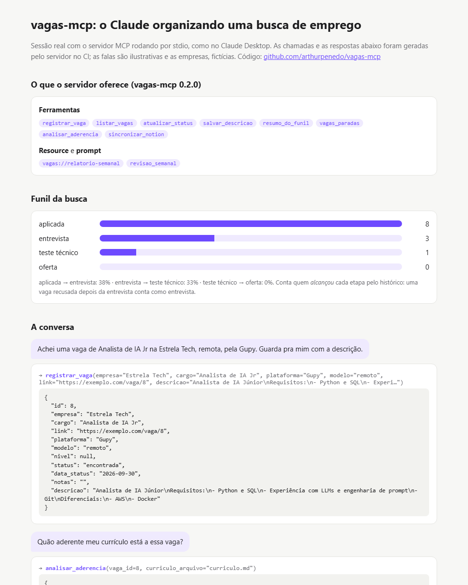

# vagas-mcp

[](https://github.com/arthurpenedo/vagas-mcp/actions/workflows/ci.yml)
[](https://github.com/arthurpenedo/vagas-mcp/actions/workflows/demo.yml)


> **Servidor MCP** (Model Context Protocol) que dá ao Claude ferramentas para organizar uma busca de emprego: registrar vagas, acompanhar o status, medir o **funil de conversão** e lembrar dos **follow-ups**.

## O problema

Quem está buscando emprego aplica para dezenas de vagas em plataformas diferentes (Gupy, LinkedIn, sites próprios) e perde o controle: onde já apliquei? Quem não respondeu há duas semanas? Minha taxa de entrevista está boa?

Com o `vagas-mcp` conectado, dá para conversar com o Claude assim:

> "Registra a vaga de Analista de IA Jr da Empresa X que achei na Gupy, é remota."
> "Apliquei na vaga 3 hoje."
> "Como está meu funil?"
> "Quais candidaturas estão paradas há mais de 10 dias?"

E o Claude chama as ferramentas certas, com os dados guardados localmente em SQLite.

## Demo

**[arthurpenedo.github.io/vagas-mcp](https://arthurpenedo.github.io/vagas-mcp/)** — sessão real com o servidor rodando por stdio (como no Claude Desktop), gerada pelo CI a cada push: cada chamada de ferramenta e a resposta que o servidor devolveu, o funil e o relatório semanal. Empresas fictícias.

[](https://arthurpenedo.github.io/vagas-mcp/)

## O que o servidor expõe

As três primitivas do MCP:

| Tipo | Nome | O que faz |
|---|---|---|
| tool | `registrar_vaga` | Cadastra uma vaga (empresa, cargo, link, plataforma, modelo, nível, notas, descrição). Bloqueia links duplicados. |
| tool | `listar_vagas` | Lista com filtro por status ou por parte do nome da empresa. |
| tool | `atualizar_status` | Move a vaga no funil (`encontrada → aplicada → entrevista → teste_tecnico → oferta`, ou `recusada`/`desisti`) e registra uma nota datada. |
| tool | `salvar_descricao` | Guarda o texto do anúncio de uma vaga já registrada. |
| tool | `resumo_do_funil` | Quantas vagas **alcançaram** cada etapa e as taxas de conversão entre etapas. |
| tool | `vagas_paradas` | Candidaturas "aplicadas" sem novidade há N dias, que pedem follow-up. |
| tool | `analisar_aderencia` | Compara um currículo (PDF, DOCX, MD) com a descrição da vaga, como um ATS: nota 0–100, habilidades que faltam e dicas. Usa o [ats-match](https://github.com/arthurpenedo/ats-match). |
| tool | `sincronizar_notion` | Envia as vagas para um banco do Notion (cria as novas, atualiza as existentes). |
| resource | `vagas://relatorio-semanal` | Resumo dos últimos 7 dias em Markdown: movimentações, funil e follow-ups. |
| prompt | `revisao_semanal` | Roteiro pronto para o Claude revisar a semana e sugerir follow-ups e mudanças de estratégia. |

## Arquitetura

```
Claude Desktop / Claude Code ──(MCP, stdio)──► server.py (MCPServer: casca fina)
                                                     │
                          ┌──────────────────────────┼──────────────────────────┐
                          ▼                          ▼                          ▼
               store.py (regras + SQLite)   ats-match (aderência)    notion.py (API do Notion)
               tabelas: vagas, historico    extra opcional [ats]     SQLite → Notion, upsert
```

### Decisões técnicas

- **Regra de negócio separada do protocolo.** `store.py` não sabe o que é MCP e é testado diretamente; `server.py` só traduz ferramentas em chamadas. Trocar de protocolo (API REST, CLI) não mexe na lógica.
- **Funil pelo histórico, não pelo status atual.** Uma vaga que chegou à entrevista e depois foi recusada **conta** como entrevista no funil. Olhar só o status atual subestimaria a conversão.
- **Local-first.** SQLite num arquivo do usuário, sem conta nem servidor externo. As instruções do servidor orientam o modelo a não registrar dados sensíveis.
- **Erros que o modelo consegue corrigir.** No MCP SDK 2.x, uma exceção comum vira um "Error executing tool" genérico e a mensagem fica no servidor. As regras de negócio (link duplicado, vaga inexistente, status inválido) são convertidas em `ToolError`, então o Claude recebe "Já existe uma vaga com este link (id 8)" e pode se corrigir. A demo mostra esse caso.
- **Notion sem template obrigatório.** O sincronizador lê o schema do banco antes de escrever e preenche cada coluna conforme o tipo dela (título, texto, select, status, URL, data). Coluna que não existe é ignorada com aviso; opção de status que não existe no Notion (a API não deixa criar) é pulada em vez de derrubar a sincronização. Vagas já cadastradas à mão são encontradas pelo link, sem duplicar.
- **SQLite como fonte da verdade, Notion como vitrine.** Mão única: funciona offline e é testável; o Notion serve para acompanhar pelo celular.
- **Migração sem perder dados.** Bancos da v0.1 ganham as colunas novas na abertura (`ALTER TABLE` só se faltar).
- **Testes pelo protocolo.** Os testes usam o cliente MCP do SDK contra o servidor em memória, a API do Notion é simulada com `httpx.MockTransport`, e a demo sobe o servidor por stdio de verdade no CI.

## Como usar

```bash
git clone https://github.com/arthurpenedo/vagas-mcp && cd vagas-mcp
pip install -e ".[dev]"          # servidor + testes
pip install -e ".[dev,ats]"      # + analisar_aderencia (instala o ats-match do GitHub)
pytest -q
python scripts/demo.py site/index.html   # gera a página da demo
```

**Claude Code:**

```bash
claude mcp add vagas -- vagas-mcp
```

**Claude Desktop** (`claude_desktop_config.json`):

```json
{
  "mcpServers": {
    "vagas": { "command": "vagas-mcp", "env": { "VAGAS_DB": "C:/Users/voce/vagas.sqlite3" } }
  }
}
```

O banco fica em `VAGAS_DB` (padrão: `~/.vagas-mcp/vagas.sqlite3`).

**Notion (opcional):** crie uma [integração interna](https://www.notion.so/my-integrations), compartilhe o banco com ela e defina `NOTION_TOKEN` e `NOTION_DATABASE_ID` no `env` acima. Os nomes de coluna esperados (Vaga, Empresa, Plataforma, Nível, Modelo, Link, Status, Data, Notas) ficam em `notion.CAMPOS`.

## Próximos passos

- [x] Sincronização com um banco do Notion
- [x] Ferramenta de aderência integrada ao [ats-match](https://github.com/arthurpenedo/ats-match)
- [x] Resource com o relatório semanal e prompt de revisão
- [x] Demo pública gerada no CI com sessão stdio real
- [ ] Importar do Notion (mão dupla)
- [ ] Vídeo de demonstração no Claude Desktop

---

Feito por [Arthur Penedo](https://github.com/arthurpenedo) · [LinkedIn](https://www.linkedin.com/in/arthurpenedo)
